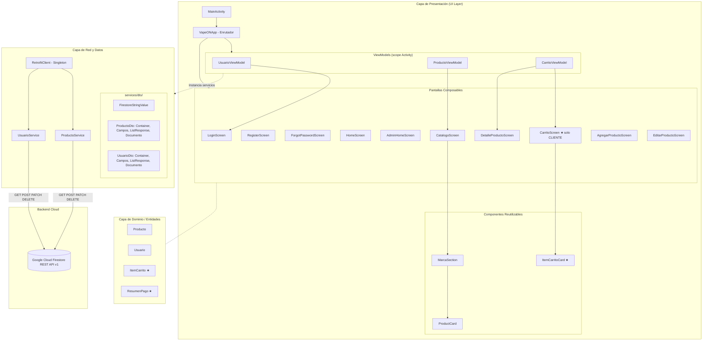

# Arquitectura del Sistema - VapeON Móvil 📱💨

Documento de especificación y diseño de arquitectura para la aplicación móvil **VapeON**, desarrollada para la plataforma Android utilizando **Kotlin** y **Jetpack Compose**.

---

## 1. Resumen Ejecutivo y Propósito

**VapeON Móvil** es una aplicación nativa para Android orientada al comercio electrónico y gestión de catálogo de productos de vapeo. Proporciona una experiencia de usuario fluida con soporte para dos perfiles de usuario principales:
- **Cliente**: Exploración de catálogo por marcas (LifePod, Oxbar, Nexa), búsqueda, detalle de producto, carrito de compras y flujo de pago (v2.0).
- **Administrador**: Gestión completa del inventario (CRUD de productos: crear, listar, editar y eliminar) y acceso al panel administrativo. **Sin acceso al carrito.**

---

## 2. Ficha Técnica y Stack Tecnológico

| Componente | Tecnología / Versión | Propósito |
| :--- | :--- | :--- |
| **Lenguaje de Programación** | Kotlin (v2.2.10) | Lenguaje base tipado y conciso con soporte para corrutinas. |
| **Plataforma Objetivo** | Android (minSdk 31, targetSdk 37, compileSdk 37) | Soporte nativo para Android 12+. |
| **Framework de UI** | Jetpack Compose (BOM 2026.02.01) | Paradigma declarativo y reactivo para UI. |
| **Sistema de Diseño** | Material Design 3 | Componentes UI modernos (Cards, Scaffolds, Drawers, Buttons). |
| **Gestión de Estado / MVVM** | `ViewModel` + `viewModelScope` + `mutableStateOf` | Estado observable que sobrevive rotaciones de pantalla. |
| **Concurrencia** | Kotlin Coroutines (`viewModelScope`, `suspend`) | Operaciones de red no bloqueantes en hilos de fondo. |
| **Capa de Red HTTP** | Square Retrofit 2 (v2.9.0) + Gson Converter | Cliente REST tipado para consumir la API de Firestore. |
| **Base de Datos / Backend** | Google Cloud Firestore (**REST API v1 — sin SDK nativo**) | Almacenamiento NoSQL en la nube vía HTTP REST puro. |
| **Gestor de Compilación** | Gradle con Kotlin DSL (`build.gradle.kts`) | Gestión modular de dependencias con version catalog. |

> **Nota importante sobre Firebase**: El proyecto utiliza **exclusivamente la REST API de Firestore** (`https://firestore.googleapis.com/v1/projects/dbvapeon/...`) vía **Retrofit**. El SDK nativo `firebase-firestore-ktx` **no está instalado** para evitar confusión. Solo se mantiene `firebase-analytics` para métricas.

---

## 3. Patrón Arquitectónico — MVVM + Single Activity

El proyecto implementa **MVVM (Model-View-ViewModel)** dentro de una arquitectura **Single-Activity** con Jetpack Compose.

### 3.1 Diagrama de Arquitectura



> ★ = Nuevo en esta versión

---

## 4. Desglose Detallado de Capas

### 4.1 Capa de Presentación — UI Layer

#### ViewModels (`viewmodels/`)
Instanciados en `VapeONApp.kt` con `viewModel()` (scope de Activity). Se pasan como parámetros a las pantallas que los consumen.

| ViewModel | Pantallas consumidoras | Estado principal | Acciones |
| :--- | :--- | :--- | :--- |
| `UsuarioViewModel` | `LoginScreen` | `usuarioActual`, `esAdmin`, `cargandoLogin`, `errorLogin` | `iniciarSesion()`, `cerrarSesion()` |
| `ProductoViewModel` | `CatalogoScreen`, `AdminHomeScreen` | `productos`, `cargando`, `error` | `cargarProductos()`, `eliminarProducto()` |
| `CarritoViewModel` | `CarritoScreen`, `DetalleProductoScreen` | `items`, `resumen`, `cantidadTotal` | `agregarProducto()`, `incrementar()`, `decrementar()`, `eliminarItem()`, `limpiarCarrito()` |

#### Pantallas (`ui/`)

- **Autenticación**: `LoginScreen`, `RegisterScreen`, `ForgotPasswordScreen`
- **Cliente**: `HomeScreen`, `CatalogoScreen`, `DetalleProductoScreen`, `CarritoScreen` (★ nueva)
- **Admin**: `AdminHomeScreen`, `AgregarProductoScreen`, `EditarProductoScreen`

#### Componentes (`components/`)
- `ProductCard.kt` — Tarjeta de producto con acciones admin opcionales
- `MarcaSection.kt` — Sección por marca con `LazyRow`
- `ItemCarritoCard.kt` (★) — Tarjeta de ítem del carrito con controles de cantidad

---

### 4.2 Capa de Dominio — Entidades (`entities/`)

```kotlin
// Producto — entidad del catálogo
data class Producto(val id: String, val nombre: String, val marca: String,
                    val precio: String, val stock: String, val descripcion: String)

// Usuario — perfil de cuenta
data class Usuario(val id: String, val nombre: String, val apellido: String,
                   val telefono: String, val fechaNacimiento: String,
                   val correo: String, val password: String, val rol: String)

// ItemCarrito ★ — ítem en el carrito del CLIENTE (local, en memoria)
data class ItemCarrito(val productoId: String, val nombre: String, val marca: String,
                       val precioUnit: Double, val cantidad: Int, val imagenRes: Int?)

// ResumenPago ★ — cálculo financiero del carrito (SubTotal + Delivery + IGV = Total)
data class ResumenPago(val subTotal: Double, val delivery: Double,
                       val igv: Double, val total: Double)
```

---

### 4.3 Capa de Red — Servicios y DTOs

#### Conexión con Firestore
```
URL base: https://firestore.googleapis.com/v1/projects/dbvapeon/databases/(default)/documents/
Cliente:  RetrofitClient (object singleton) + GsonConverterFactory
```

#### Servicios (`services/`)
Interfaces puras de Retrofit — **sin lógica de negocio**.

| Servicio | Endpoints |
| :--- | :--- |
| `ProductoService` | `GET productos` · `POST productos` · `PATCH productos/{id}` · `DELETE productos/{id}` |
| `UsuarioService` | `GET usuarios` · `GET usuarios/{id}` · `POST usuarios` · `PATCH usuarios/{id}` · `DELETE usuarios/{id}` |

#### DTOs de Transporte (`services/dto/`)
Modelan el formato JSON de Firestore REST (`fields: { campo: { stringValue: "..." } }`):

| Archivo | Clases |
| :--- | :--- |
| `FirestoreDto.kt` | `FirestoreStringValue` (primitivo compartido) |
| `ProductoDto.kt` | `ProductoContainer`, `ProductoCampos`, `ProductoListResponse`, `ProductoDocumento` |
| `UsuarioDto.kt` | `UsuarioContainer`, `UsuarioCampos`, `UsuarioListResponse`, `UsuarioDocumento` |

---

## 5. Control de Acceso por Roles (RBAC)

| Pantalla / Funcionalidad | CLIENTE | ADMIN |
| :--- | :---: | :---: |
| Catálogo (solo lectura) | ✅ | ✅ |
| Detalle de Producto | ✅ | ✅ |
| Carrito de Compras | ✅ | ❌ |
| Agregar al Carrito | ✅ | ❌ |
| Agregar Producto (CRUD) | ❌ | ✅ |
| Editar Producto (CRUD) | ❌ | ✅ |
| Eliminar Producto (CRUD) | ❌ | ✅ |
| Panel Administrativo | ❌ | ✅ |

---

## 6. Estructura de Directorios del Código Fuente

```text
app/src/main/java/com/example/vapeon_movil/
├── MainActivity.kt                      # Host único de la aplicación
├── VapeONApp.kt                         # Enrutador central + instancia de ViewModels
│
├── viewmodels/                          # Capa ViewModel (MVVM)
│   ├── UsuarioViewModel.kt              # Sesión: login, rol, logout
│   ├── ProductoViewModel.kt             # Catálogo: listar, eliminar
│   └── CarritoViewModel.kt             ★ Carrito: agregar, cantidad, resumen
│
├── entities/                            # Modelos de dominio (data classes limpias)
│   ├── Producto.kt
│   ├── Usuario.kt
│   ├── ItemCarrito.kt                  ★ Ítem del carrito (local)
│   └── ResumenPago.kt                  ★ Cálculo financiero del carrito
│
├── services/                            # Capa de red — contratos Retrofit puros
│   ├── ProductoService.kt
│   ├── UsuarioService.kt
│   └── dto/                             # DTOs de transporte Firestore REST
│       ├── FirestoreDto.kt              # FirestoreStringValue (compartido)
│       ├── ProductoDto.kt               # DTOs de producto
│       └── UsuarioDto.kt               # DTOs de usuario
│
├── ui/                                  # Pantallas Composable
│   ├── LoginScreen.kt
│   ├── RegisterScreen.kt
│   ├── ForgotPasswordScreen.kt
│   ├── HomeScreen.kt
│   ├── AdminHomeScreen.kt
│   ├── CatalogoScreen.kt
│   ├── DetalleProductoScreen.kt
│   ├── CarritoScreen.kt                ★ Nueva — solo CLIENTE
│   ├── AgregarProductoScreen.kt
│   ├── EditarProductoScreen.kt
│   ├── MenuScreen.kt
│   └── theme/
│       ├── Color.kt
│       ├── Theme.kt
│       └── Type.kt
│
├── components/                          # Componentes UI reutilizables
│   ├── ProductCard.kt
│   ├── MarcaSection.kt
│   └── ItemCarritoCard.kt              ★ Nueva — tarjeta del carrito
│
└── utils/
    └── RetrofitClient.kt               # Singleton Retrofit → Firestore REST
```

---

## 7. Flujos de Datos Clave

### 7.1 Autenticación
```
LoginScreen → UsuarioViewModel.iniciarSesion()
           → UsuarioService.listarUsuarios() [Retrofit → Firestore]
           → Busca coincidencia correo+password en memoria
           → Si ADMIN → pantallaActual = "admin"
           → Si CLIENTE → pantallaActual = "home"
```

### 7.2 Carga del Catálogo
```
CatalogoScreen → LaunchedEffect → ProductoViewModel.cargarProductos()
              → ProductoService.listarProductos() [Retrofit → Firestore]
              → Mapea ProductoDocumento → Producto
              → productos (estado) → recomposición de MarcaSection + ProductCard
```

### 7.3 Carrito de Compras (CLIENTE únicamente)
```
DetalleProductoScreen → "AGREGAR AL CARRITO"
                     → CarritoViewModel.agregarProducto(producto)
                     → Navega a CarritoScreen

CarritoScreen → Observa carritoViewModel.items
             → ItemCarritoCard: incrementar / decrementar / eliminar
             → ResumenPagoPanel: subtotal + delivery + IGV + total (calculado en tiempo real)
             → "PAGAR" → pendiente v2.0
```

---

## 8. Roadmap — Próximas Fases

| Fase | Funcionalidad | Estado |
| :--- | :--- | :--- |
| **v1.0** | Auth, Catálogo CRUD (Admin), Detalle, Carrito (Cliente) | ✅ En desarrollo |
| **v2.0** | Flujo de Pago, Persistencia del Carrito en Firestore, Pedidos | 🔜 Planificado |
| **v3.0** | Repositorio Pattern, Jetpack Navigation, Hilt DI | 🔜 Planificado |
