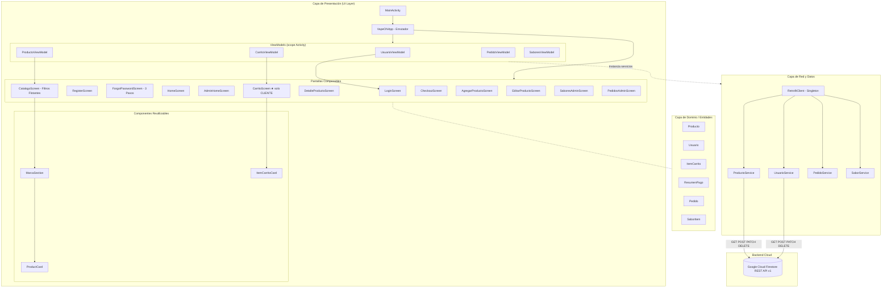

# Arquitectura del Sistema - VapeON Móvil 📱💨

Documento de especificación y diseño de arquitectura para la aplicación móvil **VapeON**, desarrollada para la plataforma Android utilizando **Kotlin** y **Jetpack Compose**.

---

## 1. Resumen Ejecutivo y Propósito

**VapeON Móvil** es una aplicación nativa para Android orientada al comercio electrónico y gestión de catálogo de productos de vapeo. Proporciona una experiencia de usuario fluida con soporte para dos perfiles de usuario principales:
- **Cliente**: Exploración de catálogo por marcas y filtros flotantes (RF12 / RF13), visualización exclusiva de productos con stock disponible (RNE01), ficha técnica, sabores propios, carrito de compras persistente localmente y proceso de checkout/pedidos.
- **Administrador**: Gestión completa del inventario (CRUD de productos: crear, listar, editar con conmutador de sabores `tieneSabor` y eliminar), supervisión de pedidos, gestión de la colección máster de sabores y acceso al panel administrativo. **Sin acceso al carrito.**

---

## 2. Ficha Técnica y Stack Tecnológico

| Componente | Tecnología / Versión | Propósito |
| :--- | :--- | :--- |
| **Lenguaje de Programación** | Kotlin (v2.2.10) | Lenguaje base tipado y conciso con soporte para corrutinas. |
| **Plataforma Objetivo** | Android (minSdk 31, targetSdk 37, compileSdk 37) | Soporte nativo para Android 12+. |
| **Framework de UI** | Jetpack Compose (BOM 2026.02.01) | Paradigma declarativo y reactivo para UI. |
| **Sistema de Diseño** | Material Design 3 | Componentes UI modernos (Cards, Scaffolds, Drawers, Buttons). |
| **Gestión de Estado / MVVM** | `ViewModel` + `viewModelScope` + `mutableStateOf` | Estado observable que sobrevive rotaciones de pantalla. |
| **Concurrencia** | Kotlin Coroutines (`viewModelScope`, `suspend`) | Operaciones de red no bloqueantes en hilos de fondo. |
| **Capa de Red HTTP** | Square Retrofit 2 (v2.9.0) + Gson Converter | Cliente REST tipado para consumir la API de Firestore. |
| **Base de Datos / Backend** | Google Cloud Firestore (**REST API v1 — sin SDK nativo**) | Almacenamiento NoSQL en la nube vía HTTP REST puro. |
| **Persistencia Local** | `SharedPreferences` + `Gson` | Almacenamiento del carrito de compras local. |
| **Gestor de Compilación** | Gradle con Kotlin DSL (`build.gradle.kts`) | Gestión modular de dependencias con version catalog. |

> **Nota importante sobre Firebase**: El proyecto utiliza **exclusivamente la REST API de Firestore** (`https://firestore.googleapis.com/v1/projects/dbvapeon/...`) vía **Retrofit**. El SDK nativo `firebase-firestore-ktx` **no está instalado** para evitar confusión. Solo se mantiene `firebase-analytics` para métricas.

---

## 3. Patrón Arquitectónico — MVVM + Single Activity

El proyecto implementa **MVVM (Model-View-ViewModel)** dentro de una arquitectura **Single-Activity** con Jetpack Compose.

### 3.1 Diagrama de Arquitectura

---

## 4. Control de Acceso por Roles (RBAC)

| Pantalla / Funcionalidad | CLIENTE | ADMIN |
| :--- | :---: | :---: |
| Catálogo (solo lectura de stock disponible RNE01) | ✅ | ✅ |
| Detalle de Producto | ✅ | ✅ |
| Carrito de Compras | ✅ | ❌ |
| Checkout y Pedidos | ✅ | ❌ |
| Historial de Compras | ✅ | ❌ |
| Agregar Producto (CRUD) | ❌ | ✅ |
| Editar Producto (CRUD + `tieneSabor`) | ❌ | ✅ |
| Eliminar Producto (CRUD) | ❌ | ✅ |
| Gestión de Sabores Máster | ❌ | ✅ |
| Administración de Pedidos | ❌ | ✅ |
| Panel Administrativo | ❌ | ✅ |

---

## 5. Historial de Versiones del Sistema

| Versión | Fecha | Descripción de Cambios |
| :--- | :--- | :--- |
| **v1.0.0** | `2026-09-26` | Versión inicial de la arquitectura MVVM, Single Activity y servicios Retrofit para Firestore. |
| **v1.1.0** | `2026-10-02` | Integración de `DetalleProductoScreen`, `ForgotPasswordScreen`, `AgregarProductoScreen`, `EditarProductoScreen` y `CircularProgressIndicator`. |
| **v1.2.0** | `2026-10-11` | Persistencia local del carrito (`SharedPreferences` + `Gson`), validaciones de formularios y control RBAC. |
| **v1.3.0** | `2026-10-30` | Flujo de recuperación de contraseña de 3 pasos con notificación flotante, filtros flotantes por marca/precio (RF12/RF13), regla de stock por rol (RNE01), conmutador `tieneSabor` e indicadores de carga estandarizados. |
