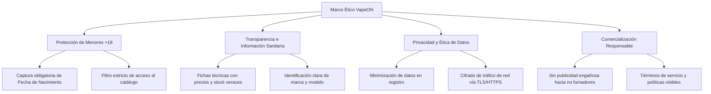
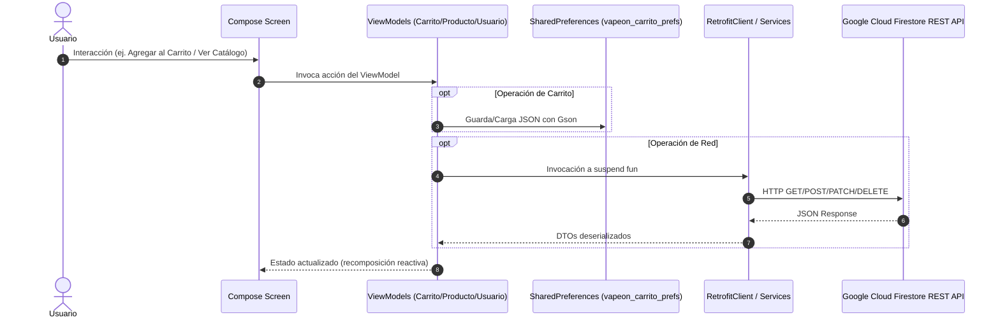

# Documento de Especificación Técnica y Ética - VapeON Móvil (`spec.md`)

| Atributo | Detalle |
| :--- | :--- |
| **Identificador** | `SPEC-VAPEON-001` |
| **Proyecto** | VapeON - Aplicación Móvil Android |
| **Versión** | `1.2.0` |
| **Estado** | `Aprobado` |
| **Fecha de Publicación** | `2026-10-11` |
| **Plataforma Objetivo** | Android (minSdk 31, targetSdk 37, compileSdk 37) |
| **Ubicación del Documento** | `doc/spec.md` (Raíz del Repositorio) |

---

## 1. Resumen Ejecutivo y Alcance

### 1.1 Declaración del Problema
El mercado de dispositivos y accesorios de vapeo requiere plataformas digitales ágiles que permitan a los usuarios mayores de edad consultar catálogos actualizados por marca y stock en tiempo real, garantizando al mismo tiempo un control estricto de acceso, veracidad en las especificaciones del producto y herramientas administrativas para la gestión del inventario.

### 1.2 Objetivos del Sistema
1. Ofrecer un catálogo digital visual e intuitivo organizado por marcas reconocidas (**LifePod**, **Oxbar**, **Nexa**).
2. Facilitar la administración centralizada del inventario (creación, edición, consulta y eliminación de productos) mediante un panel exclusivo para administradores.
3. Asegurar un entorno de navegación seguro y éticamente responsable con control de acceso basado en roles (`ADMIN` y `CLIENTE`).
4. Proveer una experiencia de carrito de compras persistente localmente con `SharedPreferences` y `Gson` para mantener los productos hasta la confirmación de pago.

### 1.3 Alcance (Scope)
- **En Alcance (In-Scope)**:
  - Registro de usuarios con captura de fecha de nacimiento para verificación de mayoría de edad.
  - Autenticación con verificación de roles en Cloud Firestore (`ADMIN` vs `CLIENTE`) con validación de campos no vacíos y mensajes de error amigables.
  - Exploración de catálogo con filtrado por marcas y visualización en tarjetas con scroll horizontal (`LazyRow`).
  - Reutilización de `CatalogoScreen` en `HomeScreen` en modo solo lectura (`esAdmin = false`) para clientes.
  - Carrito de compras persistente localmente (`CarritoViewModel` + `SharedPreferences` + `Gson`) exclusivo para `CLIENTE`.
  - Ficha técnica a detalle de cada producto en `DetalleProductoScreen` (nombre, marca, precio, stock, descripción, selector de sabores e ícono de favoritos).
  - Formulario de edición `EditarProductoScreen` y creación `AgregarProductoScreen` con subtítulos y resalte corporativo en dorado.
  - Recuperación de contraseña `ForgotPasswordScreen` con interfaz estandarizada.
  - Panel administrativo `AdminHomeScreen` con acciones CRUD completas sobre la colección de productos, carrusel interactivo y restricción de carrito.
  - Soporte para interfaz oscura nativa (*Dark Mode*) con sistema de diseño Material 3.
- **Fuera de Alcance (Out-of-Scope - Versión 1.2)**:
  - Pasarela de pagos bancarios integrada (se proyecta para versión 2.0).
  - Seguimiento de envíos por GPS en tiempo real.

---

## 2. Especificación Ética y Cumplimiento Normativo (Ethical Specification)

Dado que la aplicación comercializa dispositivos de vapeo y cigarrillos electrónicos, este apartado establece las normas éticas, legales y de protección social que rigen el diseño del software:

### 2.1 Principio de Protección a Menores de Edad (+18)
- **Restricción de Edad Estricta**: La comercialización de productos de vapeo está restringida por ley a mayores de edad (+18 años).
- **Validación en Registro**: En [RegisterScreen.kt](file:///d:/AppMovil_VapeOn/app/src/main/java/com/example/vapeon_movil/RegisterScreen.kt), el campo `fechaNacimiento` es mandatorio y debe ser auditado antes de otorgar credenciales de compra.
- **Tolerancia Cero a Cuentas Menores**: Toda cuenta que no acredite mayoría de edad legal debe ser rechazada o bloqueada de inmediato en base de datos.

### 2.2 Transparencia y Veracidad en el Catálogo
- **Fichas Técnicas Honestas**: Los campos de precio (`precio`), stock disponible (`stock`) y descripción (`descripcion`) deben reflejar con exactitud las características físicas y comerciales del producto.
- **Prevención de Fraude**: Las imágenes y especificaciones de marcas registradas (**LifePod**, **Oxbar**, **Nexa**) no deben inducir a error sobre la capacidad de inhalaciones (puffs), batería o composición de los dispositivos.

### 2.3 Privacidad, Habeas Data y Seguridad de Datos
- **Principio de Minimización**: La aplicación solo recolecta los atributos indispensables para operar: nombre, apellido, teléfono, fecha de nacimiento, correo y contraseña.
- **Seguridad en Tránsito**: Todas las comunicaciones entre el cliente móvil y Google Cloud Firestore se transmiten cifradas sobre el protocolo **HTTPS / TLS 1.3**.
- **No Comercialización de Datos Personales**: Los datos de los usuarios registrados están aislados y no son vendidos ni compartidos con redes publicitarias de terceros.

### 2.4 Matriz de Riesgos Éticos y Salvaguardas Técnicas

| Riesgo Ético / Social | Nivel de Riesgo | Medida de Mitigación Implementada en Software |
| :--- | :--- | :--- |
| Registro de usuarios menores de 18 años | **Crítico** | Validación de fecha de nacimiento en formulario y términos legales obligatorios. |
| Manipulación no autorizada de precios o catálogo | **Alto** | Verificación del rol `ADMIN` en la interfaz antes de habilitar botones de edición o eliminación. |
| Exposición de contraseñas de usuarios | **Alto** | Tráfico protegido con Retrofit HTTPS; se recomienda hash criptográfico (BCrypt/Argon2) en próximas fases. |
| Publicidad abusiva o mensajes invasivos | **Medio** | Ausencia de notificaciones push engañosas o mecánicas de ludificación orientadas al consumo compulsivo. |

---

## 3. Especificación Técnica (Technical Specification)

### 3.1 Arquitectura del Sistema
La aplicación utiliza el patrón **Single-Activity Architecture** completamente declarativo con **Jetpack Compose**, comunicándose directamente con la API REST de Google Cloud Firestore mediante **Retrofit 2** y persistiendo el carrito de compras localmente con **SharedPreferences** y **Gson**.

---

## 4. Historial de Cambios y Aprobaciones

| Versión | Fecha | Autor / Equipo | Cambios Realizados |
| :--- | :--- | :--- | :--- |
| `1.0.0` | `2026-09-26` | Equipo de Arquitectura VapeON | Creación inicial de especificación técnica y marco ético del sistema. |
| `1.1.0` | `2026-10-02` | Equipo de Arquitectura VapeON | Integración de `DetalleProductoScreen`, `ForgotPasswordScreen`, `AgregarProductoScreen`, `EditarProductoScreen` y `CircularProgressIndicator`. |
| `1.2.0` | `2026-10-11` | Equipo de Arquitectura VapeON | Integración de persistencia local del carrito de compras (`SharedPreferences` + `Gson`), validación de login sin datos y restricciones RBAC de carrito para administradores. |
