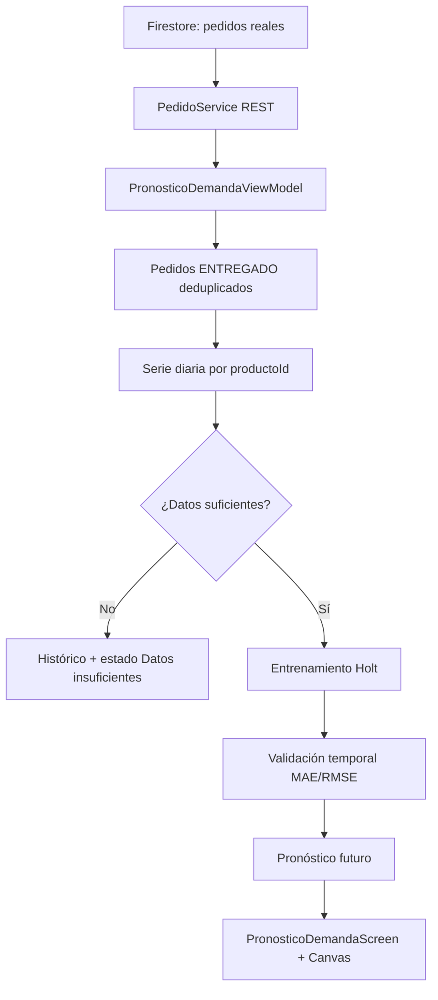
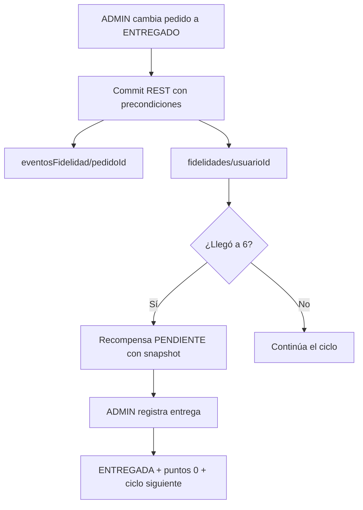

# Documento de Especificación Técnica y Ética - VapeON Móvil (`spec.md`)

| Atributo | Detalle |
| :--- | :--- |
| **Identificador** | `SPEC-VAPEON-001` |
| **Proyecto** | VapeON - Aplicación Móvil Android |
| **Versión** | `1.12.0` |
| **Estado** | `Aprobado` |
| **Fecha de Publicación** | `2026-11-14` |
| **Plataforma Objetivo** | Android (minSdk 31, targetSdk 37, compileSdk 37) |
| **Ubicación del Documento** | `doc/spec.md` (Raíz del Repositorio) |

---

## 1. Resumen Ejecutivo y Alcance

### 1.1 Declaración del Problema
El mercado de dispositivos y accesorios de vapeo requiere plataformas digitales ágiles que permitan a los usuarios mayores de edad consultar catálogos actualizados por marca y stock en tiempo real, garantizando un control estricto de acceso (+18), veracidad en especificaciones de producto y herramientas administrativas para la gestión del inventario.

### 1.2 Alcance del Sistema (Versión 1.10.0)
- **Programa de fidelidad por pedidos entregados**:
  - Cada pedido real que cambia a `ENTREGADO` y contiene productos acredita exactamente un punto al propietario identificado por `Pedido.usuarioId`, sin multiplicarlo por líneas ni unidades.
  - El progreso se limita a `0..6`; al llegar a seis se crea una recompensa pendiente y los pedidos entregados posteriores no acumulan puntos ocultos mientras continúe pendiente.
  - La entrega administrativa reinicia el progreso a cero e incrementa `numeroCiclo`; no crea pedidos, compras o pagos ni descuenta inventario.
  - `eventosFidelidad/{pedidoId}` es la clave de idempotencia. El cambio de estado, el evento, el progreso y la recompensa se envían mediante un único commit REST de Firestore con precondiciones optimistas.
  - La recompensa conserva el snapshot del producto configurado al generarse. Si no había configuración al alcanzar seis puntos, el snapshot se completa al entregar, después de que un administrador configure un producto real.
  - El cliente consulta únicamente `fidelidades/{usuarioActual.id}`; el administrador accede a configuración, ranking exclusivo de clientes y entrega mediante rutas protegidas por rol.
- **Flujo Guiado de Recuperación de Contraseña (3 Pasos)**:
  - Paso 1: Solicitud de correo con validación de sintaxis y existencia en Firestore REST. Notificación flotante simulada sobre el tope de pantalla con código de 6 dígitos.
  - Paso 2: Verificación de código de 6 casilleros dorados/oscuros (`BasicTextField` con captura directa).
  - Paso 3: Registro de nueva contraseña con toggle de visibilidad e ingreso directo a base de datos.
- **Catálogo de Productos Inteligente (RF12 / RF13 / RNE01)**:
  - Búsqueda reactiva por nombre, marca o descripción (RF12).
  - Categorías superiores: **"Todos"**, **"Nuevos"** (agregados hace máximo 1 semana / 7 días) y **"Promociones"** (`precio <= 60.0`).
  - Botón e ícono flotante de filtros (`Icons.Default.Tune`) ubicado a la izquierda del botón *"Todos"*, con modal para marcas y orden de precio (RF13).
  - Control de visibilidad de stock por rol (**RNE01**): Clientes solo ven productos con `stockTotal > 0`. Administradores ven todos los productos y los agotados muestran la etiqueta roja **"Sin stock"** en la tarjeta.
- **Ficha Técnica, Sabores e Imágenes Dinámicas**:
  - `DetalleProductoScreen` renderiza únicamente los sabores pertenecientes a dicho producto. Si fue creado sin sabor (`tieneSabor == false`), la sección de sabores se oculta.
  - `AgregarSaborScreen` y `EditarSaborScreen` permiten seleccionar una foto de sabor desde la galería o cámara, la cual se comprime y se almacena como data URI base64 en Firestore.
  - Al pulsar cualquier chip de sabor en `DetalleProductoScreen`, la imagen del producto cambia instantáneamente para mostrar la foto correspondiente a dicho sabor.
  - Si un sabor no tiene foto Base64 en Firestore, el resolvedor de imágenes `resolverImagenProducto` identifica el tipo de producto (**Kit Completo** `kitcompleto` vs **Recargas/Cartuchos** `recarga`) y muestra el drawable `muestra_...` nativo correspondiente.
- **Flujo de Checkout y Tarjetas en 4 Pasos**:
  - Registro de tarjetas simulado en 4 pasos (`AgregarTarjetaNumeroScreen`, `AgregarTarjetaExpiracionScreen`, `AgregarTarjetaCvvScreen`, `AgregarTarjetaTitularScreen`).
  - Uso de `VisualTransformation`: `CardNumberVisualTransformation` para agrupar los 16 dígitos en bloques de 4 con espacios sin saltos de cursor, y `ExpirationDateVisualTransformation` para el formato **Año / Mes** (`AA / MM`).
  - Boleta electrónica troquelada (`DatosEntregaScreen`) con número correlativo incremental (`BOLETA ELECTRONICA N° %04d`), bordes troquelados (`arreglo_boleta` / `arreglo_pedido`) y renderizado 100% dinámico de ítems reales del carrito sin datos de prueba.
  - Selección de método de pago (`MetodoPagoScreen`), dirección (`SeleccionDireccionScreen`) y tarjetas guardadas (`SeleccionTarjetaScreen`).
  - **Mapa de ubicación dentro de la app**: al pulsar **"Ver Ubicación"** en una dirección guardada se abre `VerUbicacionScreen` a pantalla completa con el SDK nativo de Google Maps (`maps-compose`), sin salir de la aplicación. La dirección se geocodifica en tiempo de ejecución con `Geocoder` y se marca en el mapa; la tecla Atrás regresa a la lista de direcciones.
  - La API key se lee desde `MAPS_API_KEY` en `local.properties` (no versionado) y se inyecta en el `AndroidManifest` como `com.google.android.geo.API_KEY`. Si no está configurada, la app muestra instrucciones en lugar de un mapa vacío.
- **CRUD de Direcciones del Cliente (colección `direcciones`)**:
  - Acceso desde la opción **"Mis direcciones"** del menú lateral del rol CLIENTE.
  - Alta, listado, edición y eliminación con confirmación; alias obligatorio, dirección obligatoria y sin duplicados por cliente.
  - `SeleccionDireccionScreen` consume las direcciones reales del cliente; la lista fija de ejemplo fue eliminada.
  - Desde el checkout se pueden agregar y editar direcciones, y "Ver Ubicación" sigue disponible para cada una.
  - El alta y la edición incluyen **selección del punto exacto en el mapa**: primero se escribe la dirección, el mapa se centra en el resultado aproximado y el cliente toca el lugar exacto antes de guardar.
  - Al confirmar el punto, la **geocodificación inversa** obtiene el nombre de la calle o lugar y actualiza el campo "Dirección de entrega".
  - `latitud` y `longitud` se guardan en Firestore; `Ver Ubicación` reutiliza esas coordenadas cuando existen.
  - Las rutas `direcciones`, `agregarDireccion` y `editarDireccion` son exclusivas de CLIENTE. Especificación detallada en `doc/specs/direcciones_spec.md`.
  - **Mapa del punto de entrega en el detalle del pedido**: el checkout copia las coordenadas de la dirección elegida al pedido; el detalle muestra un mapa de solo lectura con el marcador exacto y un botón para abrirlo a pantalla completa, tanto para el cliente como para el administrador.
  - Los pedidos históricos sin coordenadas siguen funcionando: el mapa se resuelve geocodificando el texto de `direccionEntrega`.
- **Favoritos del Cliente (colección `favoritos`)**:
  - El corazón de la ficha del producto agrega o elimina el favorito del cliente autenticado; para ADMIN permanece deshabilitado.
  - Cada documento guarda únicamente `id`, `usuarioId`, `productoId` y `fechaCreacion`; nombre, marca, precio, stock e imagen se resuelven contra el catálogo vigente.
  - La opción **"Mis favoritos"** del menú lateral abre `FavoritosScreen` con una grilla de tarjetas reales: imagen, stock, marca, nombre, precio y **"Añadir al Carrito"**.
  - El corazón de cada tarjeta elimina el favorito y el botón de compra elige el primer sabor con stock disponible.
  - Solo se consultan y eliminan documentos cuyo `usuarioId` coincide con la sesión; las rutas `favoritos` son exclusivas de CLIENTE. Especificación detallada en `doc/specs/favoritos_spec.md`.
- **Lista de Pedidos del Administrador con filtros**:
  - Filtros **"Todos"**, **"Registrados"**, **"En camino"** y **"Completados"** aplicados sobre los pedidos reales de Firestore.
  - La vista **"Todos"** oculta los pedidos entregados; estos solo se consultan en **"Completados"**, de modo que el trabajo diario muestre únicamente los pedidos registrados y en camino.
  - Cada tarjeta muestra el número secuencial, la fecha, la cantidad de ítems, el total, el estado real y el acceso **"Ver detalle"**.
  - Los filtros se aplican en memoria sobre la lista ya cargada, sin nuevas consultas ni datos de ejemplo.
- **Detalle del Pedido rediseñado**:
  - Encabezado con marca VAPEON, título "Detalle del Pedido", número secuencial y fecha real.
  - Estado, dirección de entrega, cliente y teléfono tomados del pedido en Firestore.
  - Tarjeta **"Estado del Pedido"** con pasos **R → EC → E** (Registrado, En camino, Entregado); el administrador puede tocar un paso para actualizar el estado real.
  - Listado de productos con marca, cantidad, precio unitario y subtotal reales.
  - Tarjeta **"Resumen de la Compra"** con Sub Total, Delivery, TOTAL A PAGAR, monto pagado, vuelto y método de pago.
  - El contenido se presenta sobre el fondo troquelado `arreglo_pedido`, con tipografías equivalentes a la boleta: título 14sp, etiquetas 10sp, valores 12sp y total 14sp.
  - Se conserva el mapa del punto exacto de entrega con acceso a pantalla completa.
- **Barra de Notificaciones y Menú de Administración**:
  - Configuración global en `Theme.kt` (`window.statusBarColor = VapeOnBackground` con `isAppearanceLightStatusBars = false`) para garantizar la barra de estado negra con íconos blancos y espaciado consistente.
  - Habilitación permanente de la opción **"Marcas"** en el menú de navegación lateral para el rol Administrador hacia `MarcasAdminScreen`.
- **HU-05 — Pronóstico de Demanda**:
  - Acceso exclusivo ADMIN desde `AdminHomeScreen`.
  - Lectura de snapshots reales de la colección `pedidos` mediante Firestore REST, sin crear una colección de pronósticos.
  - Solo los pedidos con `estado = ENTREGADO` forman parte del entrenamiento.
  - Las ventas se agrupan por `productoId` y día local de `America/Lima`; los días intermedios sin ventas se representan con demanda cero.
  - Modelo Holt lineal con `alpha` y `beta` ajustados mediante búsqueda acotada y selección por menor error cuadrático de entrenamiento.
  - Validación cronológica final con MAE y RMSE; nunca se mezcla aleatoriamente el orden temporal.
  - Mínimos centralizados: 14 observaciones diarias, 3 días con demanda y separación viable entre entrenamiento y validación.
  - Cuando no se cumplen los mínimos, la UI muestra el histórico real y `Datos insuficientes`, sin fabricar pronóstico.
  - Gráfica responsive con Canvas que diferencia histórico, validación y horizonte futuro.
- **Estadísticas del Administrador (día, mes y año)**:
  - Acceso exclusivo ADMIN desde el botón **"ESTADISTICAS"** de `AdminHomeScreen`.
  - Reutiliza los pedidos reales ya cargados para Caja y solo contabiliza `estado = ENTREGADO` con snapshots válidos.
  - Selector **Día / Mes / Año**, navegación al periodo anterior/siguiente y acceso directo a **"Ir a hoy"**.
  - KPIs: total vendido, pedidos entregados, unidades, ticket promedio, clientes atendidos, delivery y promedio por día/mes con ventas.
  - Evolución por franja horaria (día), por día (mes) y por mes (año), con gráfica Canvas y mejor punto del periodo.
  - Rankings de productos, marcas, categorías y métodos de pago, más comparación porcentual contra el periodo anterior.
  - Los pedidos inválidos se excluyen y se informan; no se fabrican ventas ni se modifica Caja, Pronóstico, Favoritos u otros módulos.
- **Perfil de Usuario (CLIENTE y ADMIN)**:
  - Se abre desde el avatar del menú/barra superior en `HomeScreen`, `AdminHomeScreen`, `CatalogoScreen`, `HistorialComprasScreen` y `SaboresAdminScreen`.
  - Muestra los datos reales del usuario en sesión: nombres, apellidos, correo electrónico, teléfono y fecha de nacimiento, más el rol legible (`Cliente` / `Administrador`).
  - Junto al rol se muestra el apartado **+18 Mayor de 18 años**, calculado con la fecha de nacimiento real (`dd/MM/yyyy`) y la fecha actual; si no cumple, indica **-18 Menor de 18 años**.
  - Cada campo editable abre un diálogo validado (correo, teléfono de 9 dígitos, fecha válida y mayoría de edad). Al guardar se actualiza Firestore conservando la contraseña y el rol existentes y se rechazan correos duplicados.
  - **Cambiar Contraseña** reutiliza `ForgotPasswordScreen` con el correo del usuario precargado y vuelve al perfil; **Opciones de Accesibilidad** abre el módulo de accesibilidad.
- **Módulo de Accesibilidad**:
  - Tamaño de texto **Pequeño / Mediano / Grande** (85 %, 100 % y 120 %) con slider y botones **A- / A+**.
  - Opciones **Texto en negrita**, **Contraste alto** y **Reducir transparencia**, con vista previa y **Restaurar Valores Predeterminados**.
  - Los ajustes se guardan en `SharedPreferences` (`vapeon_accesibilidad`) y se aplican globalmente con `CompositionLocal`, `Density`, `LocalTextStyle` y una matriz de color para el contraste; la escala se multiplica por la del sistema.
  - La configuración persiste entre sesiones y reinicios, y está disponible para ambos roles sin alterar filtros de pedidos, checkout ni RBAC.

---

## 2. Historial de Cambios del Proyecto

| Versión | Fecha | Autor / Equipo | Cambios Realizados |
| :--- | :--- | :--- | :--- |
| `1.0.0` | `2026-09-26` | Equipo VapeON | Creación inicial de especificación técnica y marco ético. |
| `1.1.0` | `2026-10-02` | Equipo VapeON | Integración de `DetalleProductoScreen`, `ForgotPasswordScreen` e indicadores de carga. |
| `1.2.0` | `2026-10-11` | Equipo VapeON | Persistencia local del carrito (`SharedPreferences` + `Gson`) y RBAC de carrito. |
| `1.3.0` | `2026-10-30` | Equipo VapeON | Flujo de recuperación de contraseña de 3 pasos con notificación flotante, filtros flotantes por marca/precio (RF12/RF13), regla de stock por rol (RNE01), conmutador `tieneSabor` e indicadores de carga en `VapeOnGold`. |
| `1.4.0` | `2026-11-04` | Equipo VapeON | CRUD de marcas con siembra inicial y guardas de relaciones; imagen opcional de sabor desde galería/cámara almacenada como data URI base64 en Firestore. |
| `1.5.0` | `2026-11-04` | Equipo VapeON | Flujo de tarjetas en 4 pasos con `VisualTransformation`, boleta troquelada incremental dinámica, resolvedor de imágenes por sabor/tipo (Kit Completo vs Recarga), barra de notificaciones negra global y menú de marcas. |
| `1.6.0` | `2026-11-06` | Equipo VapeON | HU-05 con series reales de pedidos entregados, ajuste Holt, validación temporal MAE/RMSE, gráfica administrativa y estado explícito de datos insuficientes. |
| `1.7.0` | `2026-11-06` | Equipo VapeON | Mapa de Google Maps a pantalla completa en `SeleccionDireccionScreen` ("Ver Ubicación"), con geocodificación de la dirección, marcador y API key leída desde `local.properties`. |
| `1.8.0` | `2026-11-06` | Equipo VapeON | CRUD de direcciones del cliente en Firestore, opción "Mis direcciones" en el menú, validaciones de duplicados y apropiación, y checkout conectado a las direcciones guardadas (se retiró la lista fija). |
| `1.8.1` | `2026-11-06` | Equipo VapeON | Selección del punto exacto de entrega en Google Maps desde los formularios de dirección: geocodificación del texto escrito, marcador ajustable al tocar el mapa y persistencia de `latitud`/`longitud`. |
| `1.8.2` | `2026-11-06` | Equipo VapeON | Geocodificación inversa al seleccionar el punto: el nombre de la calle/lugar detectado actualiza automáticamente el campo "Dirección de entrega" al confirmar el mapa. |
| `1.8.3` | `2026-11-06` | Equipo VapeON | Mapa del punto exacto de entrega en el detalle del pedido: el checkout copia `latitud`/`longitud` al pedido y el administrador ve el marcador en un mapa embebido y a pantalla completa; los pedidos antiguos se geocodifican por texto. |
| `1.8.4` | `2026-11-06` | Equipo VapeON | Lista de pedidos del administrador con filtros por estado ("Todos", "Registrados", "En camino", "Completados"), tarjetas con datos reales de Firestore y vista principal sin pedidos entregados. |
| `1.8.5` | `2026-11-06` | Equipo VapeON | Rediseño del detalle del pedido: encabezado VAPEON, datos reales del pedido, tarjeta de estado con pasos R/EC/E, productos con precio y subtotal, y resumen de compra con total, pago y vuelto. |
| `1.8.6` | `2026-11-07` | Equipo VapeON | Perfil de usuario para CLIENTE y ADMIN con datos reales, edición validada en Firestore y apartado **+18 Mayor de 18 años** junto al rol; módulo de accesibilidad (tamaño de texto, negrita, contraste alto y reducción de transparencia) persistente en `SharedPreferences` y aplicado globalmente. |
| `1.9.0` | `2026-11-08` | Equipo VapeON | Programa de fidelidad con un punto por pedido entregado, idempotencia por pedido, ciclo 0→6→0, snapshot histórico de recompensa, ranking ADMIN y consulta privada del CLIENTE. |
| `1.10.0` | `2026-11-14` | Equipo VapeON | Favoritos del cliente (`favoritos`) con alta/baja desde el corazón del detalle, pantalla "Mis favoritos" con datos reales del catálogo y opción en el menú lateral; `DetallePedidoScreen` usa el fondo `arreglo_pedido` y tipografías de boleta. |
| `1.11.0` | `2026-11-14` | Equipo VapeON | `EstadisticasScreen` y `entities/Estadisticas.kt`: reportes ADMIN por día, mes y año sobre pedidos entregados, con KPIs, evolución Canvas, rankings de productos/marcas/categorías, métodos de pago y comparación contra el periodo anterior. |

---

## 3. Especificación ética y técnica de HU-05

### 3.1 Transparencia y límites

- El módulo se denomina **Pronóstico de demanda — Modelo Holt** y no se presenta como inteligencia artificial generativa.
- No utiliza datos de clientes, direcciones, teléfonos ni información financiera para entrenar.
- No genera observaciones, ventas ni pedidos artificiales.
- La ausencia de historial suficiente se informa explícitamente; no se sustituye por promedios fijos o resultados aleatorios.
- El pronóstico es informativo y no modifica automáticamente inventario, precios ni decisiones de compra.

### 3.2 Flujo técnico

### 3.3 Criterios de aceptación

- **Dado** un pedido con estado distinto de `ENTREGADO`, **cuando** se construye el dataset, **entonces** sus cantidades no se contabilizan.
- **Dado** un producto con menos de 14 observaciones o menos de 3 días con demanda, **cuando** el administrador lo selecciona, **entonces** no se genera una serie futura.
- **Dado** un historial suficiente, **cuando** se entrena el modelo, **entonces** `alpha` y `beta` proceden del ajuste sobre los datos reales y el tramo final se reserva para MAE/RMSE.
- **Dado** un producto eliminado del catálogo, **cuando** conserva ventas históricas, **entonces** continúa disponible mediante el snapshot del pedido.
- **Dado** un usuario CLIENTE, **cuando** intenta restaurar la ruta de pronóstico, **entonces** la guardia de navegación lo devuelve a su pantalla autorizada.

---

## 4. Especificación técnica y ética del programa de fidelidad

### 4.1 Regla de negocio y ciclo

- Solo un pedido con `estado = ENTREGADO` y al menos un producto puede generar el evento.
- Un pedido genera exactamente un punto, sin depender de cantidades ni número de líneas.
- El evento acreditado es histórico: un cambio posterior del estado del pedido no revoca el punto.
- El progreso se mantiene entre cero y seis. En `6/6`, una recompensa permanece pendiente y nuevos pedidos entregados se registran como omitidos sin sumar puntos.
- Una entrega válida cambia la recompensa de `PENDIENTE` a `ENTREGADA`, reinicia a cero e incrementa el ciclo. No afecta inventario ni crea transacciones comerciales.

### 4.2 Modelo persistente

| Documento | Identificador | Responsabilidad |
| :--- | :--- | :--- |
| `configuracionFidelidad/actual` | fijo `actual` | Snapshot del producto vigente configurado por ADMIN. |
| `fidelidades/{usuarioId}` | ID del usuario | Puntos `0..6`, ciclo, recompensa pendiente y fecha de actualización. |
| `eventosFidelidad/{pedidoId}` | ID del pedido | Marcador único e histórico de acreditación u omisión. |
| `recompensasFidelidad/{recompensaId}` | usuario + ciclo | Estado y snapshot inmutable del producto de recompensa. |

La acreditación utiliza un commit REST con `exists=false` para el evento y la recompensa nueva, y `currentDocument.updateTime` para pedido y fidelidad existentes. La entrega usa las versiones leídas de fidelidad y recompensa; un segundo administrador con una versión obsoleta recibe conflicto y no produce una segunda entrega.

Si una recompensa alcanzó seis puntos sin producto configurado, su entrega incluye la configuración seleccionada en el mismo commit, protegida por `currentDocument.updateTime`. La escritura conserva exactamente sus valores y Firestore rechaza atómicamente el commit si otro administrador cambió la versión. Así, el producto confirmado visualmente no puede cambiar silenciosamente. Las recompensas que ya contienen snapshot no dependen de la configuración vigente.

### 4.3 Flujo y control de acceso

- La pantalla `Mi fidelidad` exige sesión CLIENTE y solo solicita el documento cuyo ID coincide con la sesión.
- Cuando `recompensaPendienteId` existe, `Mi fidelidad` consulta únicamente esa recompensa y muestra el snapshot histórico del producto. Si todavía no tiene producto configurado, informa que requiere configuración administrativa sin inventar nombre, marca, categoría, precio ni imagen.
- La pantalla `Cupones de fidelidad` exige sesión ADMIN, excluye usuarios ADMIN del ranking y no muestra contraseñas, teléfonos ni datos financieros.
- Las rutas restauradas se vuelven a validar contra rol y propietario de sesión.

### 4.4 Criterios de aceptación y limitaciones

- **Dado** el mismo pedido procesado repetidamente, **cuando** ya existe su evento, **entonces** el total permanece sin duplicados.
- **Dado** un progreso de cinco, **cuando** se entrega un pedido válido, **entonces** pasa a seis y se genera como máximo una recompensa.
- **Dado** un progreso de seis pendiente, **cuando** llegan otros pedidos entregados, **entonces** no supera seis ni acumula puntos ocultos.
- **Dado** un cambio de producto configurado, **cuando** se consulta una recompensa anterior, **entonces** conserva el snapshot original.
- **Dado** dos entregas concurrentes, **cuando** ambas usan la misma versión, **entonces** Firestore acepta como máximo una y la otra entra en conflicto.
- La autorización remota definitiva depende de reglas de Firestore fuera del alcance de esta versión; las guardias cliente y ViewModel reducen exposición, pero no sustituyen controles de servidor.
- No existe retroacreditación automática: los pedidos que ya estaban `ENTREGADO` antes de incorporar este módulo no generan eventos históricos ni puntos por sí solos. La fidelidad comienza con las transiciones a `ENTREGADO` procesadas por la nueva lógica; no se migran ni modifican pedidos antiguos.

---

## 5. Especificación técnica del módulo de estadísticas

### 5.1 Fuente y alcance

- La vista `EstadisticasScreen` es exclusiva del rol ADMIN y se abre desde `AdminHomeScreen`.
- La fuente es la misma consulta real de pedidos usada por Caja; no se crea una colección nueva.
- Solo se contabilizan pedidos con `estado = ENTREGADO`, deduplicados por `id` y con snapshots financieros válidos.
- Los días se agrupan en la zona horaria `America/Lima`, igual que Caja y Pronóstico.
- La vista no modifica pedidos, inventario, precios, fidelidad, favoritos ni pronósticos.

### 5.2 Periodos y métricas

| Periodo | Rango | Evolución | Métricas específicas |
| :--- | :--- | :--- | :--- |
| **Día** | Fecha local seleccionada | Franjas `00–05`, `06–11`, `12–17`, `18–23` | Total, pedidos, unidades, ticket, clientes, delivery, mejor franja |
| **Mes** | Primer y último día del mes | Días `1..longitudDelMes` | Promedio por día con ventas y mejor día |
| **Año** | 1 de enero a 31 de diciembre | Meses `Ene..Dic` | Promedio por mes con ventas y mejor mes |

Métricas comunes: total vendido (productos + delivery), ingresos por productos, delivery, pedidos entregados, unidades vendidas, ticket promedio, clientes únicos, top 5 productos por unidades, ventas por marca, ventas por categoría y métodos de pago.

### 5.3 Comparación y límites

- La comparación usa el periodo inmediatamente anterior (día anterior, mes anterior o año anterior) y calcula la variación porcentual solo si el total anterior es mayor que cero.
- No se calculan márgenes, conversión, tiempos de entrega, vistas de producto ni favoritos: esos datos no existen en los pedidos actuales.
- La fecha disponible es la de creación del pedido; no existe un timestamp de entrega, por lo que la evolución se agrupa por fecha de registro.
- Los pedidos inválidos se excluyen del cálculo y se muestran como advertencia; nunca se interpretan como ventas cero.
- Las rutas restauradas se validan contra el rol ADMIN y el propietario de la sesión.

---

## 6. Especificación técnica y ética del módulo Clientes

### 6.1 Alcance y privacidad

- El módulo es exclusivo de ADMIN y lista únicamente documentos de `usuarios` cuyo `rol` sea `CLIENTE`.
- Las tarjetas muestran nombre completo, correo, DNI, teléfono y rol. El detalle añade fecha de nacimiento y `createTime` cuando existe; nunca fabrica DNI ni fechas ausentes.
- `password` no se presenta, edita ni incluye en los modelos de visualización. El cambio de contraseña y de rol quedan fuera de este módulo; el rol continúa administrándose exclusivamente desde Roles.
- La búsqueda local admite nombre, apellido, nombre completo, correo y DNI, sin distinguir mayúsculas y de forma segura para documentos antiguos incompletos.

### 6.2 Edición y concurrencia

- Los únicos campos editables son `nombre`, `apellido`, `correo`, `dni`, `telefono` y `fechaNacimiento`.
- La actualización REST usa `updateMask.fieldPaths` exclusivamente para los campos cuyo valor cambió y `currentDocument.updateTime` como precondición optimista.
- El cuerpo nunca contiene `password`, `rol`, `createTime` ni `updateTime`. Los conflictos `409`/`412` se informan sin sobrescribir silenciosamente la versión remota.
- El correo debe ser único respecto de otros documentos; el correo actual del propio cliente no se considera duplicado. El DNI es opcional y, si se informa, consta de ocho dígitos.

### 6.3 Seguridad, UI y criterios de aceptación

- `clientes`, `detalleCliente` y `editarCliente` son rutas ADMIN y se validan junto con el propietario de la sesión. CLIENTE y una sesión inexistente son rechazados.
- La interfaz usa los tokens corporativos, superficies oscuras, estados de carga, vacío, error y reintento, además de controles táctiles de al menos 48 dp.
- **Dado** un documento ADMIN, **cuando** se carga el listado, **entonces** queda excluido.
- **Dado** un documento sin DNI o `createTime`, **cuando** se abre el detalle, **entonces** se muestra respectivamente `No registrado` o `No disponible`.
- **Dado** un documento actualizado por otro dispositivo, **cuando** el ADMIN guarda con una versión antigua, **entonces** se informa el conflicto y no se modifica el estado local.
- La aplicación aún usa Firestore REST sin Firebase Authentication. Las guardias de UI/ViewModel no sustituyen reglas remotas; con reglas que exijan `request.auth`, las operaciones reales pueden responder `403` hasta completar la migración de autenticación.
