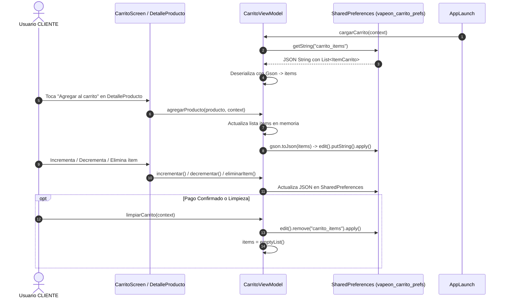

# Especificación Técnica, Ética y UI/UX - Carrito de Compras (`carrito_spec.md`)

| Atributo | Detalle |
| :--- | :--- |
| **Identificador** | `SPEC-VAPEON-CARRITO-001` |
| **Módulos / Pantallas** | `CarritoScreen`, `CarritoViewModel`, `ItemCarritoCard` |
| **Versión** | `1.0.0` |
| **Estado** | `Aprobado` |
| **Fecha de Publicación** | `2026-10-11` |
| **Plataforma Objetivo** | Android Nativo (Jetpack Compose, SharedPreferences, Gson) |
| **Ubicación del Documento** | `doc/specs/carrito_spec.md` |

---

## 1. Resumen Ejecutivo y Alcance

### 1.1 Propósito
El módulo de Carrito de Compras administra la selección de productos que un cliente tiene intención de adquirir. Garantiza la persistencia local de los ítems seleccionados entre sesiones de la aplicación, calcula reactivamente los importes financieros (SubTotal, Delivery, IGV, Total) y proporciona una experiencia de gestión de cantidades fluida hasta que el usuario decida pagar o vaciar el carrito.

### 1.2 Alcance (Scope)
- **In-Scope**:
  - **Exclusividad por Rol**: Módulo reservado únicamente para usuarios con rol `CLIENTE`.
  - **Persistencia Local**: Guardado automático de la lista de ítems en `SharedPreferences` (`"vapeon_carrito_prefs"`) serializado con `Gson` para mantener los productos tras reiniciar la app o navegar entre pantallas.
  - **Gestión de Cantidades**: Incrementar, decrementar (remueve el producto si llega a cero) y eliminar ítems individualmente.
  - **Cálculo Financiero Reactivo (`ResumenPago`)**:
    - SubTotal: Suma del precio unitario por cantidad de cada ítem.
    - Delivery: Cargo fijo de S/. 10 (aplicable si hay productos).
    - IGV (18%): Impuesto calculado sobre el SubTotal.
    - Total A Pagar: `SubTotal + Delivery + IGV`.
  - **Interfaz de Usuario (`CarritoScreen`)**:
    - `TopAppBar` con ícono de carrito, título, botón de volver y avatar de perfil circular (`VapeOnRedDark`).
    - Estado vacío con mensaje instructivo cuando la lista está desierta.
    - Panel inferior flotante de resumen de pago con botón *"PAGAR"*.
- **Out-of-Scope (v1.0)**:
  - Pasarela de pago bancario con tarjeta de crédito/débito integrada (previsto para v2.0).
  - Sincronización del carrito en la nube con Firestore para múltiples dispositivos.

---

## 2. Especificación Ética y Control de Acceso (RBAC)

1. **Restricción de Rol Estricta**:
   - Los usuarios con rol `ADMIN` no tienen permitido realizar compras ni acceder a `CarritoScreen`.
   - Si un administrador intenta navegar a la ruta `"carrito"`, el enrutador central `VapeONApp` intercepta la navegación y lo redirige automáticamente a su panel (`"admin"`).
   - El ícono del carrito en `TopAppBar` y la opción *"Carrito"* en el menú lateral (`ModalNavigationDrawer`) se ocultan cuando `esAdmin == true`.
2. **Transparencia en Cálculos**:
   - Todos los desgloses financieros (SubTotal, costo de envío e impuestos) se presentan con total claridad antes de presionar el botón de pago.

---

## 3. Especificación Técnica y Arquitectura

### 3.1 Arquitectura de Persistencia Local



### 3.2 Entidades de Dominio Involucradas

#### `ItemCarrito` ([ItemCarrito.kt](file:///d:/AppMovil_VapeOn/app/src/main/java/com/example/vapeon_movil/entities/ItemCarrito.kt))
```kotlin
data class ItemCarrito(
    val productoId: String,  // ID del documento en Firestore
    val nombre: String,      // Nombre comercial del vape
    val marca: String,       // Marca asociada
    val precioUnit: Double,  // Precio unitario
    val cantidad: Int = 1,   // Cantidad seleccionada
    val imagenRes: Int? = null
)
```

#### `ResumenPago` ([ResumenPago.kt](file:///d:/AppMovil_VapeOn/app/src/main/java/com/example/vapeon_movil/entities/ResumenPago.kt))
```kotlin
data class ResumenPago(
    val subTotal: Double,
    val delivery: Double,
    val igv: Double,
    val total: Double
)
```

---

## 4. Criterios de Aceptación y Pruebas (BDD)

### Escenario 1: Persistencia del carrito tras reiniciar la aplicación
- **Dado que** un cliente agregó 2 productos al carrito.
- **Cuando** cierra la aplicación y la vuelve a abrir.
- **Entonces** `VapeONApp` ejecuta `carritoViewModel.cargarCarrito(context)` y restaura exactamente los 2 productos con sus cantidades en `CarritoScreen`.

### Escenario 2: Protección de ruta para Administrador
- **Dado que** un usuario con rol `ADMIN` ha iniciado sesión.
- **Cuando** intenta acceder a la ruta `"carrito"`.
- **Entonces** `VapeONApp` intercepta la navegación y redirige de inmediato a la pantalla `"admin"`.

### Escenario 3: Limpieza al Pagar o Vaciar
- **Dado que** el cliente tiene productos en su carrito.
- **Cuando** ejecuta `limpiarCarrito(context)`.
- **Entonces** la lista en memoria se vacía y la clave `"carrito_items"` se remueve de `SharedPreferences`.
