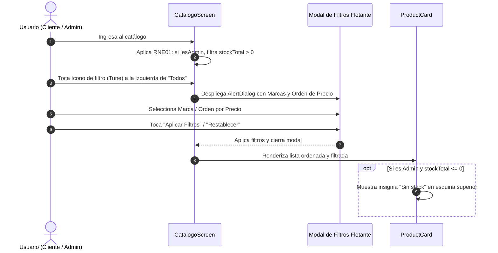

# Especificación Técnica y Ética - Catálogo de Productos (`CatalogoScreen`)

| Metadato | Detalle |
| :--- | :--- |
| **Identificador** | `SPEC-VAPEON-003` |
| **Módulo** | Catálogo de Productos con Filtros Flotantes y Regla de Stock por Rol |
| **Versión** | `1.2.0` |
| **Estado** | `Aprobado` |
| **Fecha de Creación** | `2026-09-27` |
| **Última Actualización** | `2026-10-30` |
| **Autores / Responsables** | Equipo de Arquitectura y Desarrollo VapeON Móvil |
| **Archivos Fuente** | [CatalogoScreen.kt](file:///d:/AppMovil_VapeOn/app/src/main/java/com/example/vapeon_movil/ui/CatalogoScreen.kt) · [MarcaSection.kt](file:///d:/AppMovil_VapeOn/app/src/main/java/com/example/vapeon_movil/components/MarcaSection.kt) · [ProductCard.kt](file:///d:/AppMovil_VapeOn/app/src/main/java/com/example/vapeon_movil/components/ProductCard.kt) |
| **Contenedor / Shell** | [MenuScreen.kt](file:///d:/AppMovil_VapeOn/app/src/main/java/com/example/vapeon_movil/ui/MenuScreen.kt) |

---

## 1. Resumen Ejecutivo y Objetivos del Módulo

### 1.1 Declaración del Problema
El catálogo de VapeON debe ofrecer una experiencia de búsqueda y filtrado ágil para los clientes mientras respeta el control de acceso por roles (RBAC) y la visibilidad de inventario disponible.

### 1.2 Funcionalidades y Reglas de Negocio (RF12, RF13, RNE01)
1. **RF12: Barra de Búsqueda**: Búsqueda reactiva en tiempo real por nombre del producto, marca o descripción.
2. **RF13: Categorías y Filtros Flotantes**:
   - **Categorías Principales**: Chips superiores para **"Todos"**, **"Nuevos"** (productos agregados hace máximo 1 semana / 7 días) y **"Promociones"** (`precio <= 60.0`).
   - **Ícono de Filtro Flotante (`Icons.Default.Tune`)**: Ubicado a la izquierda del botón *"Todos"*. Al pulsarlo despliega una ventana modal de filtros.
   - **Filtro por Marca**: Selección entre *"Todas"*, *"LifePod"*, *"Oxbar"*, *"Nexa"*, etc.
   - **Orden por Precio**: Ordenamiento reactivo por *"Sin orden"*, *"Menor a Mayor"* y *"Mayor a Menor"*.
   - Botón *"Restablecer"* en la ventana flotante que limpia los filtros y cierra el modal inmediatamente.
3. **RNE01: Visibilidad de Stock por Rol**:
   - **Cliente (`esAdmin == false`)**: Observa **únicamente** los productos con stock disponible (`stockTotal > 0`). Los productos agotados no se muestran en el catálogo.
   - **Administrador (`esAdmin == true`)**: Observa todos los productos. Aquellos productos con `stockTotal <= 0` muestran una insignia roja destacada **"Sin stock"** en la tarjeta `ProductCard`.

---

## 2. Especificación Técnica y Arquitectura

### 2.1 Estado Reactivo del Composable

| Variable | Tipo | Descripción |
| :--- | :--- | :--- |
| `busqueda` | `String` | Término ingresado en la barra de búsqueda (RF12). |
| `categoriaSeleccionada` | `String` | Categoria activa: `"Todos"`, `"Nuevos"` (7 días), `"Promociones"`. |
| `marcaFiltro` | `String` | Marca seleccionada en la vista flotante (RF13). |
| `ordenPrecio` | `String` | Ordenamiento: `"Sin orden"`, `"Menor a Mayor"`, `"Mayor a Menor"`. |
| `mostrarModalFiltros` | `Boolean` | Controla la visibilidad de la ventana modal flotante. |
| `productosPorRol` | `List<Producto>` | Lista filtrada según RNE01 (`if (esAdmin) productos else stockTotal > 0`). |

---

## 3. Criterios de Aceptación y Pruebas (BDD)

### Escenario 1: Cliente no visualiza productos agotados (RNE01)
- **Dado que** un usuario con rol `CLIENTE` se encuentra en el catálogo.
- **Cuando** se cargan los productos desde Firestore.
- **Entonces** únicamente se muestran aquellos productos cuya suma de stock (`stockTotal`) sea mayor a 0.

### Escenario 2: Administrador observa insignia "Sin stock"
- **Dado que** un usuario con rol `ADMIN` navega en el catálogo.
- **Cuando** un producto tiene `stockTotal <= 0`.
- **Entonces** el producto se visualiza en la lista con la etiqueta roja **"Sin stock"** sobre la tarjeta.
