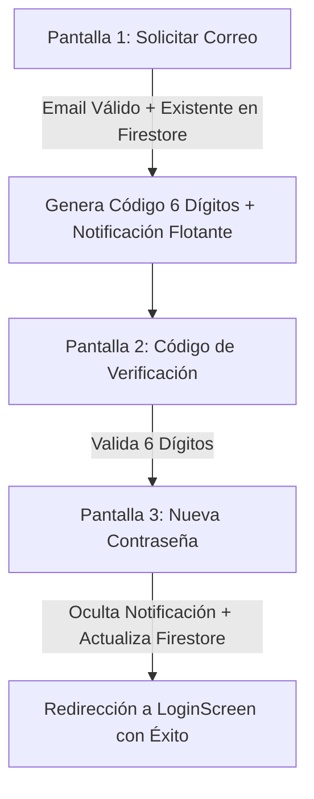

# Especificación Técnica, Ética y UI/UX - Recuperación de Contraseña (`ForgotPasswordScreen`)

| Atributo | Detalle |
| :--- | :--- |
| **Identificador** | `SPEC-VAPEON-RECUPERAR-001` |
| **Módulo / Pantalla** | `ForgotPasswordScreen` |
| **Versión** | `2.0.0` |
| **Estado** | `Aprobado` |
| **Fecha de Publicación** | `2026-10-30` |
| **Plataforma Objetivo** | Android Nativo (Jetpack Compose, Material 3) |
| **Ubicación del Documento** | `doc/specs/recuperar_password_spec.md` |
| **Archivos Fuente** | [ForgotPasswordScreen.kt](file:///d:/AppMovil_VapeOn/app/src/main/java/com/example/vapeon_movil/ui/ForgotPasswordScreen.kt) · [UsuarioViewModel.kt](file:///d:/AppMovil_VapeOn/app/src/main/java/com/example/vapeon_movil/viewmodels/UsuarioViewModel.kt) |

---

## 1. Resumen Ejecutivo y Alcance

### 1.1 Propósito
La pantalla `ForgotPasswordScreen` gestiona el flujo de trabajo guiado en 3 pasos para la recuperación segura de contraseñas olvidadas por los usuarios de VapeON. Implementa notificaciones simuladas dentro de la app, verificación de 6 dígitos con casilleros directos e integración con Firestore para la actualización reactiva de credenciales.

### 1.2 Alcance (Scope)
- **In-Scope**:
  - **Paso 1 (`¿Olvidaste tu Contraseña?`)**: Campo de Correo Electrónico, validación sintáctica (`correoRegistroValido`) y verificación de existencia del usuario en la base de datos de Firestore. Generación de código aleatorio de 6 dígitos.
  - **Notificación Flotante Simulado**: Tarjeta de notificación (`Card`) flotante sobre el tope de la pantalla con elevación (`10.dp`), que muestra el código generado sin desplazar los elementos de la interfaz.
  - **Paso 2 (`CÓDIGO DE VERIFICACIÓN`)**: Captura directa dentro de 6 casilleros dorados/oscuros (`BasicTextField` con `decorationBox`), sin cuadro de texto secundario.
  - **Paso 3 (`NUEVA CONTRASEÑA`)**: Formulario para la nueva contraseña y su repetición, con íconos dorados de ojo para alternar la visibilidad de texto plano. Ocultamiento automático de la notificación flotante al ingresar a este paso.
  - **Sincronización de Base de Datos**: Método `actualizarContrasenaPorCorreo` en `UsuarioViewModel` para actualizar la contraseña en Firestore REST API.
  - Divisor con conector **"o"** y botón secundario **"Volver"** estilizado en rojo oscuro (`VapeOnRedDark`).

---

## 2. Especificación de Validaciones y Seguridad

| Paso | Validación | Criterio / Regla de Negocio | Mensaje de Error en UI |
| :--- | :--- | :--- | :--- |
| **Paso 1** | Campo Vacío | `correo.isBlank()` | *"Por favor ingresa tu correo electrónico"* |
| **Paso 1** | Formato de Correo | `!correoRegistroValido(correo)` | *"Ingresa un correo electrónico válido (ejemplo: usuario@dominio.com)"* |
| **Paso 1** | Existencia en Firestore | `verificarExisteUsuarioConCorreo(correo) == false` | *"El correo ingresado no se encuentra registrado en VapeON"* |
| **Paso 2** | Longitud Completa | `codigoIngresado.length < 6` | *"Ingresa los 6 dígitos del código de verificación"* |
| **Paso 2** | Código Correcto | `codigoIngresado != codigoGenerado && codigoIngresado != "123456"` | *"Código incorrecto. Ingresa el código enviado en la notificación."* |
| **Paso 3** | Campos Vacíos | `nuevaContrasena.isBlank() \|\| repetirContrasena.isBlank()` | *"Por favor ingresa y repite tu nueva contraseña"* |
| **Paso 3** | Longitud Mínima | `nuevaContrasena.length < 6` | *"La contraseña debe tener al menos 6 caracteres"* |
| **Paso 3** | Coincidencia | `nuevaContrasena != repetirContrasena` | *"Las contraseñas no coinciden"* |

---

## 3. Especificación de UI/UX y Componentes

- **Contenedor Flotante**: `Box(modifier = Modifier.fillMaxSize())` que aloja la `Column` desplazable y la `Card` de notificación flotante alineada en `Alignment.TopCenter`.
- **Notificación Flotante**: `Card` en color `VapeOnBorder`, borde dorado, elevación `10.dp`, ícono `Icons.Default.Notifications` en `VapeOnGold`.
- **Casilleros de Código OTP (Paso 2)**: 6 casillas redondeadas `RoundedCornerShape(12.dp)` de fondo `VapeOnCardBackground` (`#3F321B`) con borde en `VapeOnGold` al recibir dígitos.
- **Campos de Contraseña (Paso 3)**: `OutlinedTextField` con trailing icon de ojo en `VapeOnGold`.
- **Botón Principal**: `Button` en `VapeOnRed` (`#ED2025`), forma píldora `RoundedCornerShape(50)`.
- **Botón Secundario**: `Button` en `VapeOnRedDark` (`#5B181C`), ejecuta el retroceso de paso o retorno al Login.

---

## 4. Criterios de Aceptación (BDD Spec)

### Escenario 1: Flujo completo exitoso de recuperación
- **Dado que** el usuario ingresa un correo registrado en VapeON en el Paso 1.
- **Cuando** pulsa *"RECUPERAR CONTRASEÑA"*, se valida su existencia, aparece la notificación flotante con el código de 6 dígitos y pasa al Paso 2.
- **Y** en el Paso 2 digita los 6 casilleros y pulsa *"VERIFICAR"*.
- **Y** en el Paso 3 ingresa una contraseña válida de más de 6 caracteres y pulsa *"REGISTRAR CONTRASEÑA"*.
- **Entonces** el sistema actualiza la contraseña en Firestore REST API y lo redirige a la pantalla de inicio de sesión.
